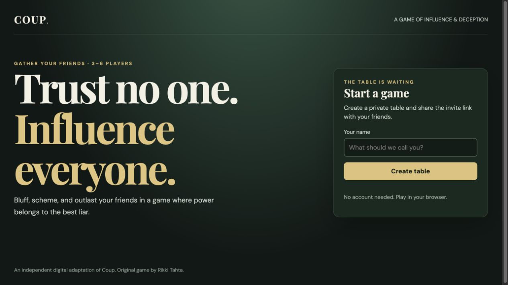
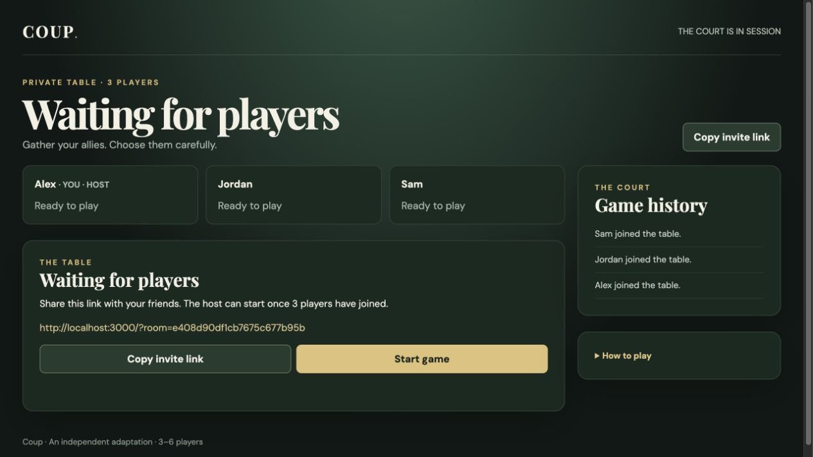
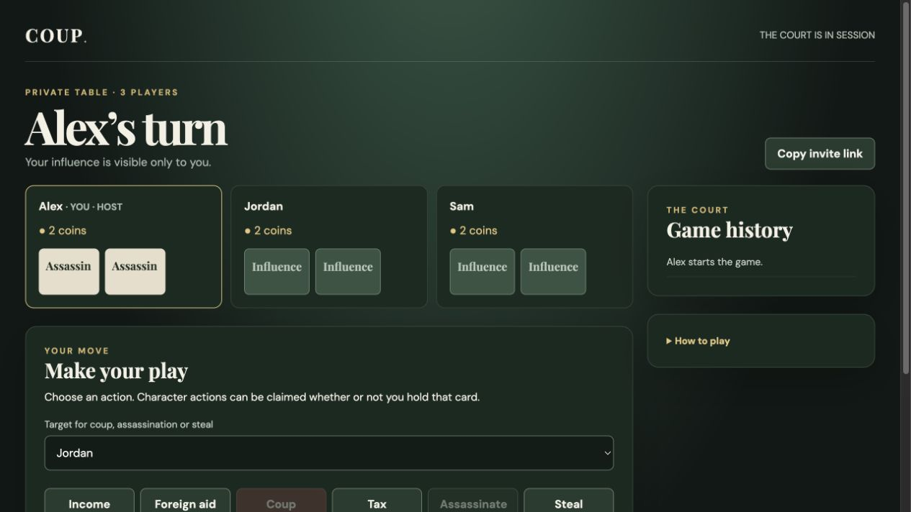
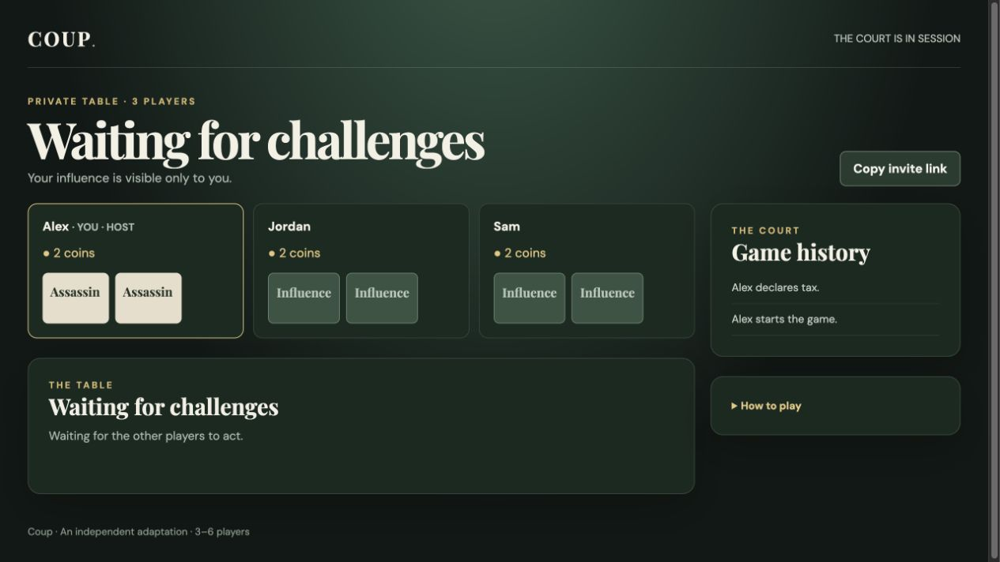
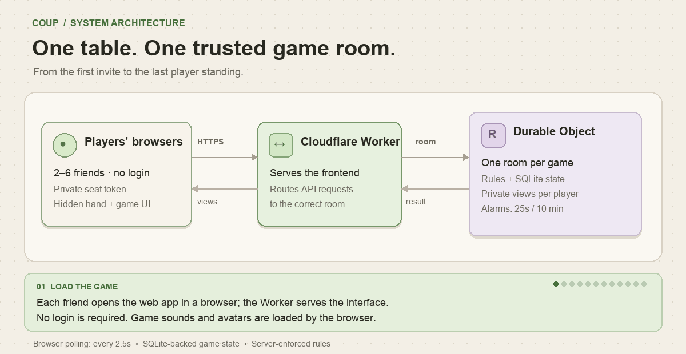

# Coup for friends

A small independent browser adaptation of the base game of Coup for 2–6 friends. Create a room, share its invite link, and play without accounts. The server enforces turns, challenges, blocks and hidden hands. Players have 15 seconds to challenge a character claim; anyone who does not respond automatically passes. Blocking decisions are untimed.

## Play locally

The local game server requires Node.js 20 or newer. For installing the Cloudflare tooling, use a Node version supported by the CLI (currently Node 22.23+, 24.22+ or 26.12+):

```sh
npm test
npm run dev
```

Open http://localhost:3000. To play on the same local network, use your computer's LAN address and port 3000 instead; the built-in local server keeps rooms only in memory, so restarting it clears games. A local address is not accessible to friends over the internet without additional networking.

Create a table, share the link and wait for 2–6 players. The host starts the game. Each player must use their own browser profile or device: a room seat is saved in local storage so a refresh can reconnect it. Clearing browser storage loses that seat. Keep the link private; anyone with it can join an open lobby. Do not share your browser session, because its token controls your seat. All eligible players can respond to a challenge; unanswered challenges automatically pass after 15 seconds. Blocking decisions do not have a timer. A disconnected player can reconnect in the same browser; there is no kick option. Use **Exit game** to leave; in an active game this forfeits your influence. **New game** leaves the current table and creates a fresh one. Rooms expire after 10 minutes without a player joining, leaving, or making a game move; merely keeping the page open does not reset the timer.

## How a game is played

1. **Create a table.** Enter a name and select **Create table**. No account is needed.

   

2. **Invite your friends.** Copy the invite link and share it. Once 2–6 players have joined, the host starts the game.

   

3. **Take your turn.** Your own influence cards appear face up to you; other players’ cards stay hidden. Select a target if the action needs one, then choose an action. You can claim a character even when you do not hold it.

   

4. **Respond to claims.** Other players can pass, challenge a character claim, or make an eligible block. The table waits until the required responses are in. When an influence is lost, its owner chooses which card to reveal. The last player with influence wins.

   

Screenshots show an example local game; room links and cards change each game.

## Architecture



The browser sends moves and polls for updates. The Worker routes each room to its own Durable Object, which enforces the rules, stores the game state, returns each player a private view, and schedules response and inactivity timeouts. The local Node server uses the same game rules with in-memory rooms.

To regenerate the diagram, run `python3 scripts/generate_architecture.py` with Pillow installed.

## Cloudflare deployment

The Worker in `src/worker.js` uses a SQLite-backed Durable Object per room; static files live in `public/`. Cloudflare's Workers Free plan includes Durable Objects, within [free usage limits](https://developers.cloudflare.com/durable-objects/platform/pricing/). Polling every 2.5 seconds consumes requests while a tab is active; limits can be reached, and free-tier availability is not guaranteed. Review your Cloudflare account's plan and limits before deploying.

Install the Cloudflare CLI and Vite plugin dependencies, authenticate with your own Cloudflare account, then run the project build and deploy commands:

```sh
npm install
npx cf auth login
npx cf build
npx cf deploy
```

Change the Worker name in `cloudflare.config.ts` if needed. Cloudflare account setup and a workers.dev subdomain may be required. Idle rooms are automatically removed after 10 minutes without player activity. The current implementation is intended for small private games, not a hardened public service: it has no rate limiting, moderation or lobby recovery.

## Rules and scope

The base game uses three each of Duke, Assassin, Captain, Ambassador and Contessa. Character actions and blocks can be bluffed; claims can be challenged. Losing a challenge costs influence; a proven card is shuffled back and replaced. A coup costs seven coins and must be taken at ten or more. The last player with influence wins. See the [rulebook](https://northstreetgames.com/images/Rulebooks/Coup-Rules.pdf). In a two-player game, the starting player receives one coin and the other receives two. The optional two-player character-selection variant and expansions are not included. Original game designed by Rikki Tahta; this is an independent fan implementation and is not affiliated with its publisher.

See [PLAN.md](PLAN.md) for the implementation plan.
